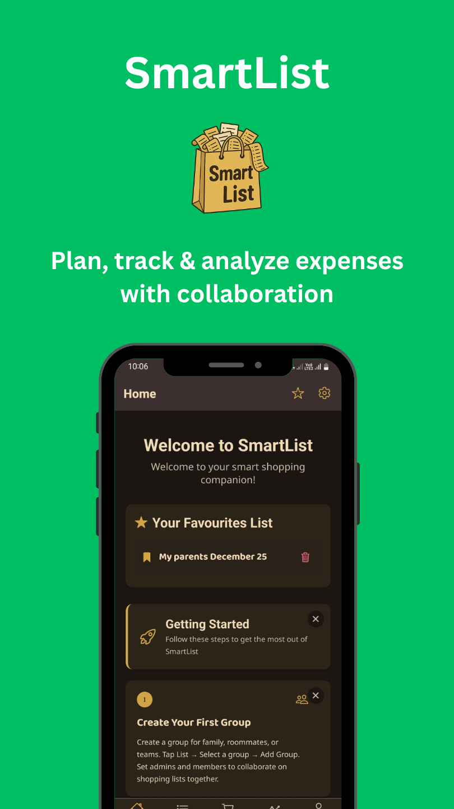
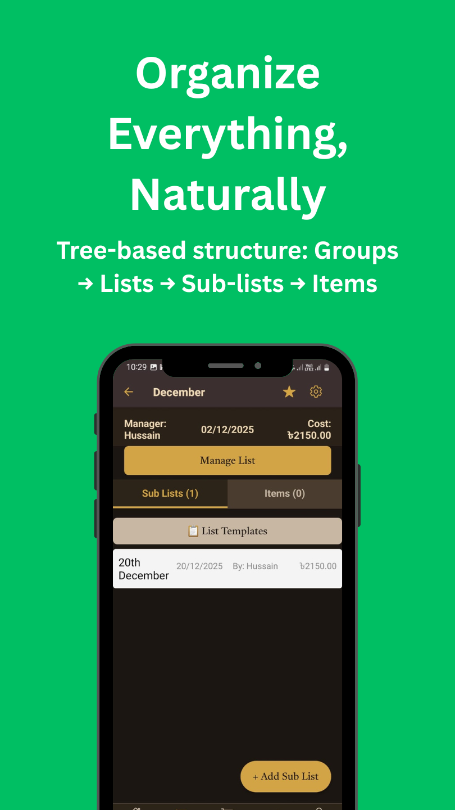
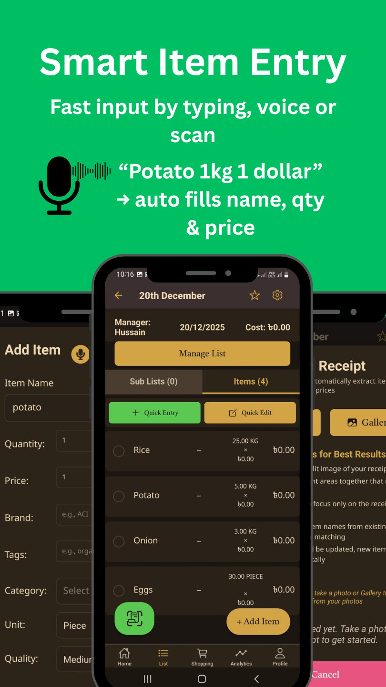
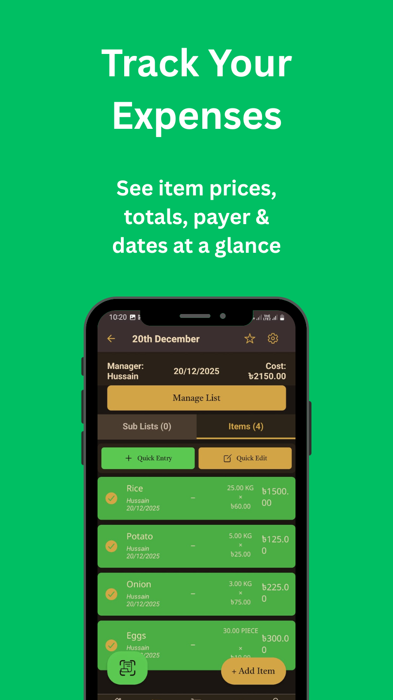
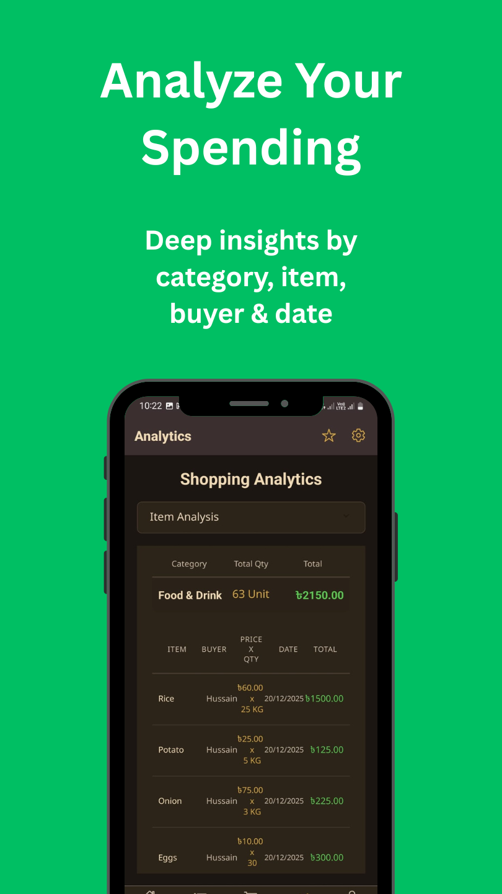
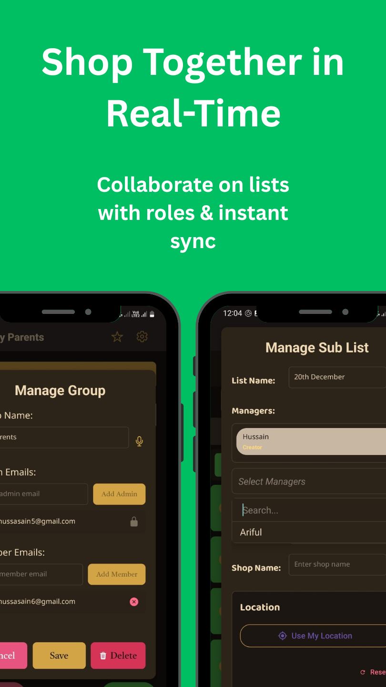
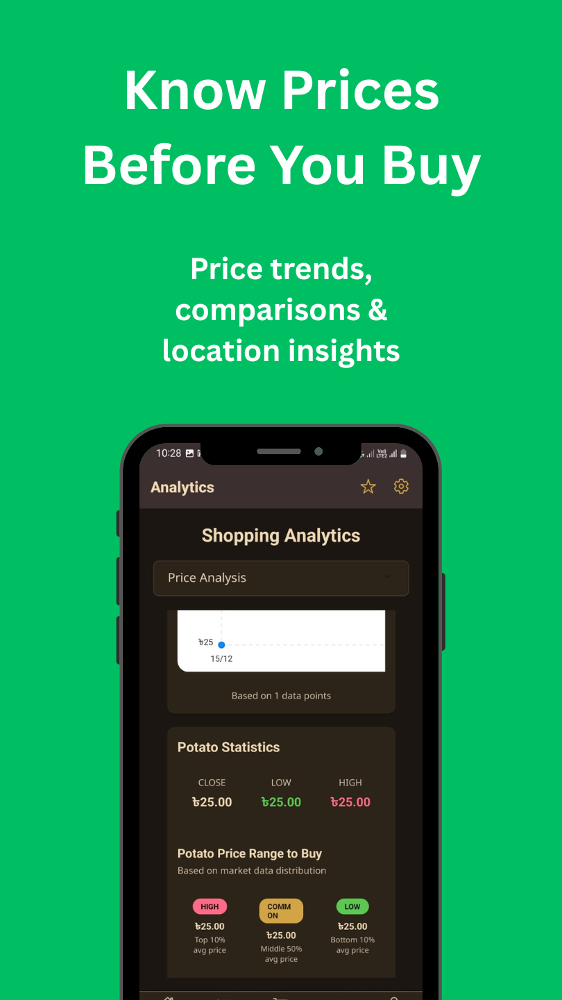
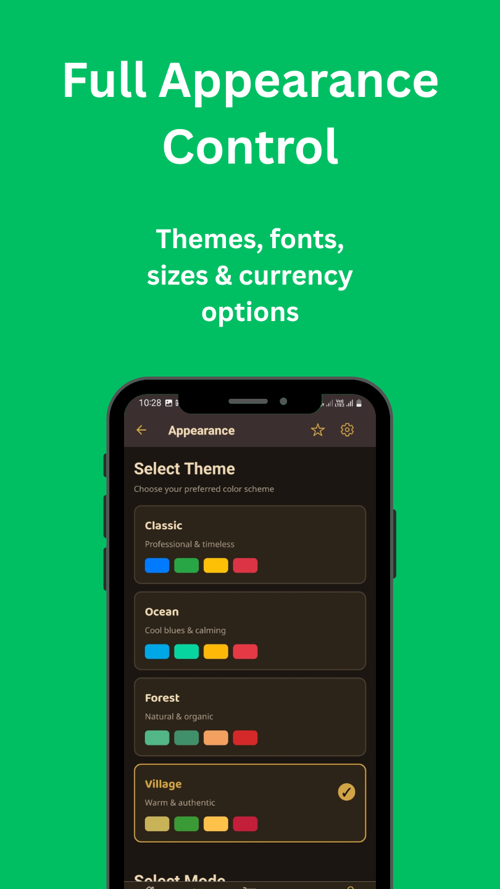
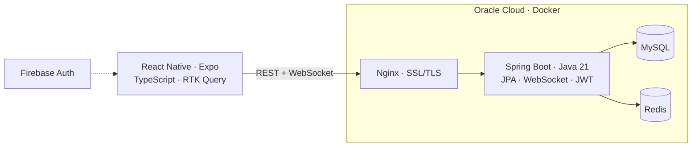

<h1 align="center">SmartList</h1>

<b>Plan, track and analyse shopping and shared expenses, together.</b>

  
  
  
  

> Showcase repository. The source code is private; this page covers the product, its architecture and the engineering behind it.
> Built solo by [Md. Al Hussain Talukder](https://github.com/alhussaintalukder) · Al Hussain Smart Solution

---

## 📱 Screenshots

  
  
  
  

  
  
  
  

## 💡 Why SmartList
It started with 14 housemates sharing groceries and bills in spreadsheets, which led to confusion and disputes. In South Asia, many families also settle shop bills monthly rather than per purchase. SmartList brings lists, expenses, shops and analytics into one collaborative app.

## ✨ Features
- 🌳 **Tree organisation:** Groups → Lists → Sub-lists → Items
- 👥 **Real-time collaboration:** share groups with family, roommates or teams, with admin and member roles, synced instantly over WebSocket
- 📊 **Analytics:** price trends, budget forecasting, spending by category, item, buyer or period
- 🧾 **Receipt scanning:** in-house OCR, with no third-party APIs
- 📍 **Location intelligence:** in-house reverse geocoding (country → division → district → thana), nearby shops, regional price comparison
- 🏪 **Shops:** shop owners and customers, orders, VAT and discounts, and due/advance/balance tracking
- 🗣️ **Voice and quick entry**
- 🌐 **Offline-first** with automatic sync
- 🇧🇩 **English + বাংলা** · light and dark themes

## 🏗️ Architecture

| Layer | Technology |
|---|---|
| Mobile | React Native, Expo, TypeScript, Redux Toolkit / RTK Query |
| Backend | Java 21, Spring Boot, Spring Data JPA, WebSocket, JWT |
| Data | MySQL, Redis cache |
| Auth | Firebase Authentication (Google + email) |
| Infra | Docker, Nginx, SSL/TLS on Oracle Cloud Infrastructure |
| Release | EAS Build → Google Play |

## 🛠️ Engineering highlights
- Designed, built, deployed and published **solo**: 276 commits across the mobile and backend monorepo
- Real-time sync, plus an offline-first data layer
- Custom OCR and geolocation pipelines instead of paid third-party APIs
- Started as my BUET PGD final project and grew into a production app

## 📬 Contact
Feedback, partnerships or similar product builds: **md.alhussain365@gmail.com** · [alhusso.com](https://alhusso.com)
